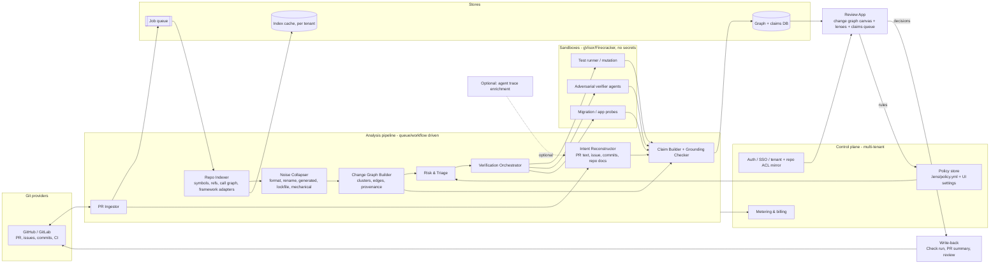
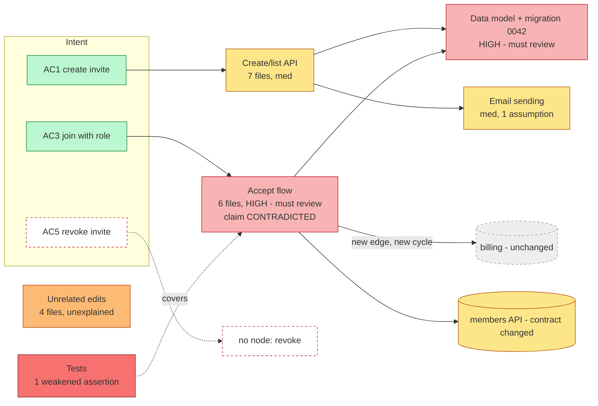

# Reviewing Agent-Written Code: Architecture and Design

Working name: **Lens** (a review layer between coding agents and merge).
Status: draft v0.2, greenfield. Date: 2026-10-22.

Revision notes (v0.2) - constraints added by the user:
1. Commercial multi-tenant SaaS product, not an internal tool (see 3.11, 3.12).
2. Must work on **any PR after the fact**. No dependence on generation-time capture; agent traces are optional enrichment only (ADR-1 rewritten).
3. A **separate review app** that reads PRs from GitHub/GitLab and writes review results back (ADR-3 rewritten).
4. The central UI concept is a **zoomable change-impact graph** (3.8, ADR-4), evaluated including where it fails.

---

## 0. Thesis in one paragraph

A human cannot read 2,000 lines of plausible code they did not write and reliably find what is wrong. They can, however, reliably judge **claims, behaviours, contracts and risks**, provided each one is cheap to inspect and tied to evidence. So the unit of review changes from "hunk" to "**claim with evidence**". The system captures the agent's intent at generation time, builds a semantic model of what changed, runs independent verification, and presents a layered review (summary, then risk, then code) where code is the last resort rather than the starting point. The central interface is a **zoomable graph of the change** (system, then features, then functions, then hunks) on which intent, risk and evidence are overlaid, backed by a claims queue that guarantees completeness. The goal is not to replace reading code. It is to make the reviewer read the 5% of code that matters, and to prove (not assert) the other 95% is fine.

---

## 1. Problem decomposition

### 1.1 Why diff review breaks down

| # | Failure | Mechanism | Severity (1-5) |
|---|---------|-----------|----------------|
| 1 | **No mental model** | The reviewer did not write it. Human review of human code leans on the author's context plus the reviewer's familiarity. With agent code, neither exists, so the reviewer must reconstruct the design from fragments before judging it. This is the root cause; most others amplify it. | 5 |
| 2 | **Intent mismatch is invisible in a diff** | A diff shows *how* text changed, not *whether it does what was asked*. "Correct code for the wrong requirement" passes any line-level reading. The spec/plan is not in the diff. | 5 |
| 3 | **Plausibility camouflage** | Agent code is idiomatic, well named, commented. Surface quality, the cue humans use to estimate correctness, is decoupled from actual correctness. Errors live in semantics: off-by-one on permissions, wrong default, wrong tenant scoping. | 5 |
| 4 | **Volume vs. attention budget** | Reviewer attention is roughly fixed (about 200-400 LOC per hour at useful quality, and falling off after 60 minutes). Agents emit 10x that. Result: skim, then approve. Review quality degrades non-linearly past about 400 LOC. | 4 |
| 5 | **Silent assumptions and scope creep** | The agent decides unstated things (a default role, a token TTL, a retry policy, "also refactored X"). Decisions are buried inside code, never surfaced as decisions. | 4 |
| 6 | **Test weakening and swallowed errors** | Agents optimise for "green". They loosen assertions, delete or skip tests, add `try/except: pass`, mock the thing under test, add `// TODO`. These are small hunks in large diffs and are the highest-signal cheating. | 4 |
| 7 | **Duplicated or reinvented utilities** | The agent lacks (or ignores) global repo knowledge, so it writes `formatDate` for the 6th time. A diff cannot show what is *absent* from it (the existing helper that should have been used). | 3 |
| 8 | **Diff ordered by file, not by logic** | Alphabetical file order scatters one logical change across 12 files, and mixes unrelated changes in one. Reviewers cannot hold the thread. | 3 |
| 9 | **Behaviour is not in the diff** | Runtime behaviour (what the endpoint now returns, what the migration does to 40M rows, what happens under concurrency) is only inferred from static text. | 4 |
| 10 | **Review-fatigue feedback loop** | Agents make PRs bigger and more frequent, which lowers per-PR scrutiny, which makes approval a ritual, which lets worse code in. | 3 |
| 11 | **Authority and automation bias** | "The AI wrote it and CI is green" nudges approval. Likewise for an AI reviewer's summary: a fluent summary is itself a plausibility-camouflaged artefact. | 3 |
| 12 | **Lost rationale** | Rejected alternatives and dead-ends in the agent's session vanish. Six months later nobody knows why it is built this way. | 2 (now), 4 (later) |

### 1.2 What hurts most (ranking)

1. **Missing mental model (1) + intent mismatch (2).** If these are fixed, the reviewer can *judge*. If not, no amount of better diff tooling helps.
2. **Plausibility camouflage (3).** Dictates that we must not rely on reviewer "smell"; we need evidence that is independent of how the code reads.
3. **Volume (4) and behaviour-invisibility (9).** Dictate triage and executable evidence.
4. **Silent decisions and test weakening (5, 6).** Cheap to detect mechanically; high yield. These are the best MVP targets.

Design consequence: the system's primary job is **reconstructing the mental model** and **converting hidden decisions and behaviours into explicit, checkable claims**. Summarisation is secondary.

---

## 2. Reframing the unit of review

### 2.1 From lines to claims

Old unit: `hunk in file`.
New unit: **Claim** = a falsifiable statement about the change, with evidence and a verdict.

Examples:
- "Only workspace admins can create invitations." Evidence: authz check at `invitations/service.ts:41`; test `admin_only` passes; verifier attempted member-role bypass: failed to bypass.
- "Invitation tokens expire after 7 days." Evidence: constant `INVITE_TTL`; **not in the spec** → flagged as an *assumption*.
- "No existing behaviour changed outside invitations." Evidence: API-surface diff shows 0 modified endpoints; but `User` model gained a column → flagged.

### 2.2 The review objects (what a human reviews)

| Object | Question the reviewer answers | Source |
|---|---|---|
| **Intent ↔ outcome** | Did it build what I asked, nothing more, nothing less? | Spec/plan vs. semantic change model |
| **Behaviour changes** | What can a user/system do now that it could not before, or no longer can? | Tests, API diff, running the app |
| **Contracts / interfaces** | Did public signatures, API schemas, events, error codes change? | AST/OpenAPI/proto diff |
| **Data and schema** | Is the migration safe, reversible, backfilled, indexed? | Migration analysis, dry-run on snapshot |
| **Risk surfaces** | Auth, money, deletion, concurrency, crypto, PII, external calls, migrations: did they get human eyes? | Rules + path/symbol classifiers |
| **Decisions** | Which choices did the agent make, and are they acceptable? | Agent trace + post-hoc detection of unstated ones |
| **Test evidence** | Do tests actually constrain the behaviour (not just pass)? | Mutation testing, test-diff analysis |
| **Dependency / architecture impact** | New deps, new layers, new cross-module edges, duplicated utilities? | Dependency graph diff, similarity search |

### 2.3 Progressive disclosure: four layers

```
L0  Verdict card      30 sec   "Mergeable after 3 decisions; 2 risk areas need eyes"
L1  Claims & decisions 5 min   Intent coverage, assumptions, scope creep, behaviour changes
L2  Risk-surface review 15 min Focused semantic diffs on must-review items only, with evidence
L3  Code               on demand Exact lines, grouped by logical change, reached via a claim
```

Rules:
- Every higher layer item **links down** to exact code (file, line, commit SHA). No claim without a citation.
- Every code region is reachable from at least one claim, or is labelled **"unexplained code"** (a finding by itself; see 4.3).
- The reviewer can always drop to plain diff. We never hide code; we change the entry point.
- In the UI these layers are **semantic zoom levels of the change graph** (Z0-Z3, section 3.8), not separate screens.
- Sampling: for low-risk, verified claims, a random sample (e.g. 1 in N) is forced into the reviewer's view to keep the verification honest (see section 6).

---

## 3. System design

### 3.1 Component diagram



### 3.2 Data flow (happy path, works on any PR)

1. **Trigger**: webhook (PR opened/updated, or user pastes a PR URL in the app). Idempotency key: `(tenant, repo, base SHA, head SHA, pipeline version)`.
2. **Ingest**: fetch PR metadata, description, linked issues, commits, review comments, CI check results, file changes. Partial clone at base and head into an ephemeral worker.
3. **Index**: load the cached base-branch index (incremental, see 3.12); index only changed files plus their neighbours on head.
4. **Collapse noise** (3.8.4) before anything expensive runs.
5. **Reconstruct intent** (3.3) from text sources, independent of the diff.
6. **Build the change-impact graph** (3.8) and cluster hunks into logical changes.
7. **Risk and triage** (3.5) annotate nodes/edges; **verification** (3.6) runs in tiers; **claims** are built, grounded and attached to graph elements.
8. **Review app** shows the graph; reviewer decisions are stored and **written back** (status check + summary + optional review) to the provider.
9. On new pushes, only symbols whose content hash changed are re-analysed; unchanged claims carry over.

### 3.3 Intent reconstruction (post-hoc, no trace required)

Intent must come from sources **independent of the code**, then be compared with what the code actually does. Sources, ranked by trust:

1. Linked issue/ticket body and comments (GitHub issues, Jira/Linear via optional connectors): acceptance criteria.
2. PR title and description (including checklists, "follow-ups", "not in this PR").
3. Commit messages and commit sequence (a proxy for the plan; also reveals "fix flaky test" style weakening).
4. PR conversation and review threads.
5. Repo conventions: `CONTRIBUTING`, ADRs, `AGENTS.md`/`CLAUDE.md`, sibling code patterns.
6. Optional trace enrichment (hooks/SDK): plan, declared decisions, uncertainty. Upgrades claim origin to `agent_declared`; absence never degrades the core pipeline.

Pipeline:
- **Stated intent**: extract requirements and acceptance criteria (ACs) from sources 1-4. Shown to the reviewer for one-click confirmation or edit (cheap, high leverage). If nothing exists, a banner says "no intent source" and prompts for a one-sentence intent; confidence caps at low.
- **Inferred behaviour**: derived from the change graph and verification (new endpoints, state changes, new constants/limits/dependencies). Derived without reading the stated intent, to avoid the model rationalising the code.
- **Delta** = stated minus inferred (missing ACs, "claimed but not done") plus inferred minus stated (scope creep, silent assumptions). The delta is the finding; neither side alone is trusted.
- **Detected decisions**: with no trace, "decisions" are inferred from code: a chosen constant, library, sync-vs-async, pattern that deviates from sibling modules. Rejected alternatives are inferred from repo conventions (e.g. "a job queue exists and 3 modules use it for email-like work; this PR sends inline").

### 3.4 Semantic change model

- **Layers**: file → symbol (function/class/type) → logical change set.
- **Hunk grouping**: cluster by call-graph connectivity, shared new symbols, commit provenance (and plan steps when a trace exists), and co-modified tests. LLM may *name* clusters but clustering and membership are deterministic first; LLM refines only ambiguous hunks and must not drop any hunk (invariant: union of clusters = full diff, checked mechanically).
- **Facts extracted deterministically**: added/removed/changed public signatures; new endpoints/events/routes (OpenAPI/GraphQL/proto diff); schema/migration ops (add column nullable? drop? lock-taking?); new dependencies and licenses; new cross-module imports; deleted/skipped/loosened tests; removed error handling; new `catch`-and-ignore; new env vars/config; call-graph blast radius (transitive callers of modified symbols).
- **Duplication/reinvention**: embed new function bodies and search the repo's existing symbols (AST-normalised similarity + embeddings); flag "new `parseDuration` is 90% similar to `utils/time.ts:parseDur`".
- **Language support**: TypeScript/JavaScript and Python first (tree-sitter + LSP), others via tree-sitter fallback with fewer facts.

### 3.5 Risk scoring and triage

Goal: decide what **must** get human eyes, and justify it.

Inputs (all deterministic where possible):
- **Surface classifiers**: path/symbol rules + project-specific risk map (auth, payments, deletion, crypto, PII, migrations, concurrency primitives, external I/O, infra/IaC, CI config, permissions).
- **Change characteristics**: public contract change, new dependency, test weakened, error swallowed, size of logical change, churn in historically buggy files (from git blame/incident links).
- **Verification gaps**: changed lines not covered by tests; survived mutants; claims with no evidence.
- **Agent signals**: unexplained code; when a trace exists, also low declared confidence and flip-flopping. Agent authorship is detected heuristically (trailers, bot users, PR templates) and only tunes thresholds.

Output per logical change: `risk = {level: low|med|high|blocker, reasons[], must_review: bool}`.

Policy (explicit, versioned in repo as `.lens/policy.yml`):
- `must_review` whenever any hard rule fires (e.g. touches `auth/**`, a migration that drops/rewrites, test removed). Hard rules cannot be overridden by a model score.
- A model-based score may **raise** risk but never lower a hard-rule outcome. (Asymmetric: LLMs can escalate, not de-escalate.)
- Reviewer must attest on every must-review item; the PR cannot be approved via Lens until all are resolved.

### 3.6 Automated verification

Run in ephemeral sandboxes (containers), network-restricted, with the repo at head SHA.

| Check | What it gives | Notes |
|---|---|---|
| Existing tests + new tests, **baseline vs. head** | Regression and new-behaviour evidence | Run the new tests against the *base* too: a new test that passes on base proves nothing. |
| **Mutation testing** (scoped to changed symbols) | Do the tests constrain behaviour? | Cheap when scoped (Stryker, mutmut). Survived mutants become findings. |
| **Test-diff analysis** | Weakened/deleted/skipped assertions, over-mocking | Deterministic. High yield. |
| **Property/invariant checks** | Invariants from spec or learned from reviewer rules ("tenant_id always in query") | Generated by verifier agent, run for real. |
| **App runner / API probes** | Observed behaviour: start app, hit new endpoints, capture request/response | Produces behaviour evidence (recorded transcripts). |
| **Migration dry-run** | Duration, locks, row effects on a seeded snapshot; rollback test | Hard evidence for data risk. |
| **Adversarial verifier agents** | Try to break each high-risk claim | Separate model/prompt/context from the author. Goal-directed: "produce a failing input or test for claim C". Output is an *executable repro or nothing*; prose opinions are not evidence. |
| Static analysis, secrets, SAST, dependency audit | Standard hygiene | Reuse existing tools; don't rebuild. |

Evidence has a typed schema (`test_run`, `mutation_result`, `http_transcript`, `repro_script`, `static_finding`, `llm_opinion`). The UI visibly ranks evidence strength: **executed > deterministic static > LLM opinion**. `llm_opinion` alone can never mark a claim "verified".

### 3.7 Core data model (abridged)

```ts
type Claim = {
  id: string
  statement: string                 // falsifiable, one sentence
  kind: 'intent_coverage'|'behaviour'|'contract'|'data'|'security'|'assumption'|'scope'|'test_quality'|'dependency'
  origin: 'issue'|'pr_text'|'agent_declared'|'derived'   // where it came from
  citations: CodeRef[]              // {path, startLine, endLine, sha} must resolve
  anchors: GraphRef[]               // node/edge ids in the change graph this claim overlays
  evidence: Evidence[]              // typed, with strength
  status: 'verified'|'unverified'|'contradicted'|'needs_decision'
  confidence: number                // calibrated, see section 6
  risk: RiskAssessment
  reviewer?: { decision: 'accept'|'reject'|'question'; note?: string; at: string }
}
type LogicalChange = { id; title; hunks: HunkRef[]; symbols: SymbolRef[]; planStep?: string; claims: string[]; risk }
```

### 3.8 Review app: the change-impact graph

#### 3.8.1 What the graph is (and is not)

It is **not** the repo's call graph (unreadable, and mostly irrelevant). It is the **change-impact subgraph**: the changed elements, plus unchanged neighbours within k hops (default k=1, up to 2 on demand) shown as dimmed "ghost" nodes to convey blast radius. It is built at several granularities from the same underlying data and is rendered by **semantic zoom** (the level changes with zoom, and aggregated edges are recomputed per level).

Layout: layered left-to-right by data flow (entry points: routes, jobs, UI events, public API; then services; then persistence and external calls). The **intent column** (acceptance criteria) is pinned on the far left. Tests sit in a band underneath, linked by `covers` edges so they do not tangle the main graph. No force-directed hairballs: layout must be stable between pushes so the reviewer's mental map survives a fix-up commit.

Budget: at most about 40 nodes and 80 edges visible per view; beyond that, nodes collapse into a "+23 more (summary)" cluster. Large graphs are a signal in themselves ("this PR is too big; consider splitting").

#### 3.8.2 Zoom levels

| Level | Name | Nodes | Edges | Reviewer question |
|---|---|---|---|---|
| **Z0** | System / module | Modules, packages, services, plus external anchors (DB schemas, queues, third-party APIs, infra). Size = change volume, colour = max risk. Unchanged 1-hop neighbours as ghosts. | Module dependencies (imports, service calls, shared tables, events). **New and removed edges highlighted**; new cycles flagged. | "Where did this land? Did the architecture change? Does it touch things it should not?" |
| **Z1** | Feature / logical change | Logical-change clusters ("Accept flow", "Invitation data model"), public contract anchors (endpoints, events, tables, config keys), intent nodes (ACs). | Depends-on and data-flow between clusters; `implements` from intent to clusters; `covers` from test clusters. | "Does this decompose into what I asked for? Is anything unexplained or missing?" |
| **Z2** | Symbol | Functions, methods, classes, types, routes, tables/columns, migrations, components, config keys. Changed ones solid; unchanged neighbours ghosted. | Calls (static), data access (reads/writes table/field), type/contract sharing, event publish/subscribe, DI bindings, config reads, `covers`. Each edge carries **provenance**: static / observed (from test coverage traces) / inferred (LLM or heuristic, labelled hypothesis) / unresolved. | "How does a request flow through this? What else calls the thing that changed?" |
| **Z3** | Hunk | The actual diff hunks inside one symbol, shown as an AST-aware semantic diff (side by side, moved code detected, formatting ignored), with claims attached to exact lines. | Intra-symbol flow only (optional). | "Is this code correct?" |

Interaction:
- Double-click drills in place (siblings dim); breadcrumb `System > Invitations > acceptInvite() > hunk 2`; every view is URL-addressable (shareable review links).
- **Path focus**: select two nodes and see the changed path between them. **Tour mode**: an ordered walk through must-review nodes along data flow, which gives the missing mental model a reading order (fixes failure #8 and #1).
- Edge-type toggles (calls, data, events, config, tests) to cut clutter.
- Z3 is always reachable and a plain unified diff is always one click away. Every changed line shows which graph node and claims cover it.

#### 3.8.3 Overlays: risk, intent and claims on the graph

| Overlay | Rendering |
|---|---|
| **Risk triage** | Node fill = risk level; thick halo = `must_review`; reason chips on hover ("touches `auth/**`", "NOT NULL migration on 11M rows"). Z0/Z1 nodes inherit the max of their children, so risk "bubbles up" and is visible when zoomed out. Risky *edges* too: a new call from `invitations` to `billing`; a route reaching the DB without the usual middleware. |
| **Intent vs. implementation** | ACs are nodes in the intent column with `implements` edges to the clusters/symbols that realise them. Colours: evidenced (green), implemented but unverified (amber), **no implementing node (red hollow node, no edges)**, contradicted (red). Changed nodes with **no intent edge** are drawn as orange "unexplained" nodes (scope creep / silent assumptions). Assumption markers (diamond) sit on the node holding the hard-coded TTL/limit. |
| **Claims** | Badge on the node or edge a claim anchors to (count and worst status). Clicking opens the claim card (statement, evidence by strength, accept/reject/ask). A claim such as "only the invited email's owner can accept" anchors to the `accept` route to service edge and the comparison hunk. |
| **Verification evidence** | Small icons: test executed, mutant survived, repro attached, probe run. Evidence strength ordering as in 3.6. |
| **Review progress** | Node outline: unreviewed, accepted, rejected, questioned. A **coverage ring** on the canvas shows the share of changed lines whose owning node was examined or accepted, and which must-review items remain. |
| **Expected-but-absent** | Dashed ghost nodes drawn from the gaps analysis (see 3.8.6 case "missing"). |

The graph is the **canvas** (orientation, blast radius, reading order, where risk clusters). The **claims queue** (a linear list in a side panel, ordered by risk) is the **checklist** that guarantees completeness: the PR cannot be marked reviewed until the must-review items in the queue are resolved. Both bind to the same claims and graph ids, so selecting in one highlights in the other.

#### 3.8.4 Collapsing noise

Applied before graph construction; collapsed items remain inspectable and are counted ("hidden: 31 files, 4,200 lines; why?").

| Noise | Detection | Treatment |
|---|---|---|
| Formatting / whitespace / import reorder / comment-only | AST equality after normalisation | Dropped from graph; one "no semantic change" tally; verified mechanically (so it cannot hide a real change). |
| Renames and moves | git rename detection plus AST/hash similarity of moved symbols | One node with a "moved/renamed from" badge; edges preserved; only residual edits inside shown as hunks. |
| Generated files | Header markers, `.gitattributes linguist-generated`, known generator outputs, path rules | Collapsed into the source node that generates them ("regenerated from schema.prisma"). If the generator is known, re-run and confirm the output is exactly reproducible. |
| Lockfiles / vendored / snapshots | Filename and path rules | Single "Dependencies" node: added / removed / bumped direct and transitive packages, licences, advisories. Snapshot updates listed with a flag if assertions changed. |
| Large mechanical edits | Cluster hunks by identical AST transformation signature | One "pattern" node: rule, an exemplar, **and the outliers that do not match the pattern** (where the bugs hide). Typecheck/compile result as evidence. |
| Test fixtures / data | Path rules | Collapsed under the test band. |

#### 3.8.5 Graph construction

- Symbols and references from tree-sitter plus language-specific indexers (SCIP/LSIF-style; TypeScript compiler API, pyright/jedi first). Base-branch index cached per repo; head indexed incrementally.
- **Framework adapters** (Express/Nest/FastAPI/Django/Rails routes, ORM models to tables, DI containers, job registrations, event bus topics) turn conventions into explicit nodes and edges. This is where static graphs usually fail, so adapters are a first-class investment.
- Data-access edges from SQL/ORM parsing; contract anchors from OpenAPI/GraphQL/proto/JSON schema; event topics and config keys as shared anchor nodes (this is also how cross-language edges are drawn).
- Edge provenance is stored and rendered; "unresolved" markers appear on call sites that static analysis cannot resolve (reflection, dynamic dispatch, string-keyed handlers).
- Observed edges: when tests run (tier B), coverage traces add edges for dynamic dispatch the static pass missed.

#### 3.8.6 Does a graph cover every case? Honest evaluation

Verdict: **the graph is the best surface for orientation and for placing overlays, but it is not a complete review surface**. It answers "what is connected to what and where is the risk"; it is weak whenever the thing to be judged is not a connection. Design response: the graph is the index and canvas, and every node can open a **lens** (a specialised view) suited to its kind. A coverage invariant ensures nothing escapes: every changed hunk belongs to a graph node, or to a non-graph node (config group, docs, assets, data) that opens the right lens.

| Case | Why the graph is weak | Complementary view (lens) |
|---|---|---|
| **Config / infra / YAML** (k8s, CI, Terraform, env files) | No call graph; meaning is in effective values and consumers | **Config lens**: typed key-level diff, effective-value diff after env/overlay resolution, consumers of each key (usage search), IaC plan output (`terraform plan`, `kubectl diff`) as evidence. A resource-topology graph (same engine, different node kinds) for infra-heavy PRs. |
| **SQL migrations / schema** | The danger is operation semantics, locks, data volume, reversibility; the graph only shows table linkage | **Data lens**: before/after schema, ordered operation list with safety rules (NOT NULL without default, drop, type rewrite, missing index), dry-run on seeded snapshot (duration, locks), rollback test, code readers/writers of affected columns (from the graph). |
| **CSS / UI / visual changes** | Visual correctness is not structural; the component tree says little | **Visual lens**: before/after screenshots (Storybook/Playwright), responsive and dark-mode variants, a11y diff, component usage fan-out from the graph. |
| **Test-only changes** | Graph shows test-to-subject links, not whether tests constrain behaviour | **Test lens**: assertion-level diff (loosened/removed/skipped), base-vs-head runs, mutation results, over-mocking detection. |
| **Large mechanical refactors** | Graph explodes into hundreds of near-identical edges | **Pattern lens**: rule + exemplar + outliers; automatic equivalence evidence (typecheck, tests, codemod re-run). Graph collapses to one pattern node. |
| **Deleted code** | Removed nodes vanish; the risk is what still depends on them or what behaviour was lost | **Removal lens**: tombstone nodes with red edges to remaining references (including string-keyed/dynamic, docs, flags, routes, SDKs), deleted tests, orphaned data/config. |
| **Cross-language boundaries** (TS client to Python API, SQL in strings, protobuf) | Edges must be inferred; index tooling differs per language | Contract anchors (OpenAPI/proto/schema) as explicit nodes; **Contract lens** shows schema diff with consumers on both sides. Inferred edges are labelled as such. |
| **Dynamic dispatch / DI / reflection / metaprogramming / event buses** | Static analysis misses edges, so blast radius looks falsely small | Framework adapters; observed edges from test coverage; "unresolved call sites" badges; text-search lens for string-keyed handlers. The UI must never show "no other callers" without stating the analysis limits. |
| **What is MISSING** (no auth check, no rate limit, no audit log, no test, no revoke endpoint) | A graph draws what exists; absence has no node | **Gaps lens**, feeding dashed "expected" nodes: (a) ACs with no implementing node, (b) sibling-pattern comparison (other routes have auth middleware, validation, audit log, tests; this one does not), (c) checklist rules per risk surface (money: idempotency key; deletion: soft-delete/audit; migration: down-step), (d) removed guards. This is the single largest gap of a graph-only design, hence the mandatory intent column and gaps analysis. |
| **Security flows (taint)** | Data-flow paths are graph-like but need path-sensitive analysis | **Path lens**: source-to-sink taint paths rendered as a linear trail with each hop's code; SAST output as evidence. |
| **Concurrency, performance, algorithmic complexity** | Emergent properties of execution, not structure | Verification evidence (load/race probes where feasible), risk rules for locks/transactions/N+1 patterns; honest "not checked" labels. |
| **Cross-cutting edits** (logging, metrics, error wrapping added everywhere) | Fan-out noise | Pattern lens (as for mechanical refactors). |
| **Docs / prose / assets** | No semantics | Collapsed under a "non-code" node with plain diff; docs-vs-behaviour check as a claim. |
| **Tiny PRs** | Graph is overkill | Skip straight to Z2/Z3 or the claims queue; default view adapts to PR size. |

Failure risks specific to a graph UI, and mitigations:
- *Hairball*: node/edge budgets, clustering, stable layout, edge-type toggles.
- *False reassurance from missing edges*: provenance on every edge, "unresolved" markers, never state absence of impact without limits.
- *Pretty but not actionable*: every node leads to a decision (accept / reject / ask); the queue enforces completion.
- *Graph as theatre*: the same rubber-stamp countermeasures apply (6.1); a fully green graph still gets forced sampling of nodes.
- *Learning curve*: default entry is the L0 verdict plus "start tour"; the free-form canvas is optional.

Research to run early: a comprehension study comparing graph-first, queue-only and file-diff on seeded PRs (see MVP success criteria). If the graph does not beat the queue-only view on defect detection or comprehension, demote it from "central" to "navigation aid" without rework of the backend (the model is shared).

### 3.9 Feedback loops

- Reviewer rejects a decision ("don't add a new dependency for this") → "Convert to rule" drafts a policy entry or a lint/invariant (`.lens/rules/*.yml`, also exportable to `CLAUDE.md`/`AGENTS.md` so the *agent is told next time*, closing the loop at generation time).
- Repeated reviewer overrides on a rule → surface "this rule is noisy" for pruning.
- Escaped defects (bug traced to merged PR): link back, ask "which claim/verification should have caught this?", and propose a new check. This is the primary learning signal.
- All rule changes are PRs to the repo, reviewed by humans. The system never silently changes policy.

### 3.10 Integration points

| Integration | Role |
|---|---|
| **GitHub App / GitLab app** | Read: PRs, diffs, commits, issues, review comments, check results, repo contents (least privilege). Write-back: a **check run** (`lens/review`) with conclusion derived from human decisions on must-review items; a short PR comment with the L0 verdict and deep link to the review app; optionally a **PR review** (comment / request changes / approve). Approvals are submitted with the reviewer's own user-to-server token where possible so attribution is to the human, not the bot. |
| **Auth** | OAuth/SSO via the provider. The app re-checks repo access with the user's token on each request, so Lens never shows code a user cannot see in the provider. |
| **Issue trackers** (Jira, Linear, GitHub Issues) | Pull linked ticket and acceptance criteria. |
| **CI** | Ingest existing test, coverage, lint and SAST results (cheap tier A evidence); optional job to run Lens verification in the customer's own CI. |
| **Entry points to the app** | "Open in Lens" links from the check run details URL, a PR-comment deep link, and (later) a browser extension adding a button on PR pages. Cheap, avoids a context-switch cost. |
| **Optional trace enrichment** | Claude Code hooks/MCP, SDK wrappers: send plan and declared decisions keyed by branch/commit trailer. Nice-to-have, not required. |
| **Later** | IDE plugin for pre-PR local review, API/webhooks for customers' own automation, Slack notifications. |

### 3.11 Multi-tenant SaaS, security of customer code, onboarding

**Tenancy model.** Organisation (tenant) > provider installation > repos > PRs. Tenant id on every row (row-level security) and in every object-store key prefix; per-tenant envelope encryption (KMS data keys); no cross-tenant caches of code-derived data. Per-tenant concurrency quotas and rate limits to prevent noisy neighbours.

**Handling customer source code (the primary sales objection).**
- Least-privilege GitHub App (contents: read, pull requests: write, checks: write, issues: read, metadata). No push access. Short-lived installation tokens.
- Ephemeral analysis workers; partial/shallow clones deleted after the job. Persist **derived metadata** (graph, claims, hashes) and only the **code excerpts cited by claims**; full-source retention is off by default. Configurable retention and deletion API.
- Execution of customer code only in sandboxes (gVisor/Firecracker microVMs): no network by default, no secrets, CPU/memory/time quotas, read-only base image. Tests of untrusted PRs are a real attack surface (the PR author may be malicious), so network egress is denied and secrets are never injected.
- LLM usage: contractually zero-retention, no training on customer data; regional endpoints; secret scanning and redaction before any code leaves our boundary; prompt-injection hardening (PR text and repo files are data, never instructions; structured outputs; verifiers have no credentials).
- Enterprise: **customer-hosted analysis runner** (VPC agent) with the SaaS control plane only seeing metadata/claims; BYO LLM endpoint or key; SSO/SAML, audit log; SOC 2 Type II as a go-to-market gate; private-link options.

**Onboarding (time-to-value under 15 minutes, no CI changes).**
1. Install the GitHub/GitLab app, choose repos.
2. Async indexing of the default branch (minutes, incremental thereafter); auto-detect languages, frameworks, test commands, generated paths.
3. **Backfill demo**: automatically run on the last 3-5 merged PRs (including any that later had reverts or hotfixes) so the user sees the product on their own code before any live PR.
4. Suggested risk map generated from repo structure (paths that look like auth, payments, migrations); one-click confirm into `.lens/policy.yml`.
5. First live PR: advisory check run plus deep link. Verification **tier A** works with zero setup; **tier B** (execution) is opt-in per repo via reading existing CI results first, then optional sandbox setup.

### 3.12 Cost drivers and pricing implications

Value must be delivered at a per-PR cost small relative to a reviewer's hour. Cost drivers, in rough order of expected weight (to be measured early; figures are hypotheses):

| Driver | Scales with | Notes / levers |
|---|---|---|
| **Adversarial verifier agents** (multi-turn LLM with tool use plus sandbox time) | Number of high-risk claims | Likely the largest variable cost. Run only on must-review claims; cap budget per PR; escalate depth by risk. |
| **LLM analysis**: intent extraction, cluster naming, claim drafting, gap analysis | Changed lines, number of clusters (intent extraction roughly constant per PR) | Deterministic collapse first (lockfiles, generated, formatting never reach an LLM); route classification/triage to small models, reserve frontier models for claims and verifiers; prompt caching of repo context. |
| **Sandbox compute**: base-vs-head tests, mutation testing | Test suite time x mutation multiplier (10-50x unless scoped) | Scope mutation to changed symbols; reuse customer CI results; affected-test selection. |
| **Indexing** | Repo size (amortised), then changed files per push | Per-repo cached index, incremental by file hash; shared nowhere across tenants. |
| **Re-runs on every push** | Pushes per PR | Symbol-hash incremental re-analysis; debounce; only re-verify claims whose anchors changed. |
| **Storage and graph serving** | Retained PRs | Small (metadata and excerpts). |

Order-of-magnitude expectation for a 2,000-line PR: LLM spend from a few tenths of a dollar (tier A) to several dollars (with verifiers), plus sandbox cents to dollars. Instrument per-PR cost from day one.

Pricing implications (recommendation, to validate):
- Base: **per active developer or per active repo per month**, including a pool of "analysed PR units" where a unit is size-tiered (e.g. up to 500 / 2,000 / 10,000 changed non-noise lines). Noise-collapsed lines do not count (fair and aligned with our own cost).
- **Deep verification credits** as the metered add-on (verifier agents, mutation, app runs), because they are the variable-cost, high-value part.
- Enterprise: platform fee plus customer-hosted runner discount (they pay the compute).
- Default depth policy: tier A on every PR (cheap, fast, under 2 minutes for L0), tier B triggered by risk rules or by a reviewer click. This is both the margin lever and the UX (fast first paint, deep results stream in).
- Guardrails: per-PR budget cap, per-tenant monthly budget alerts, graceful degradation ("deep checks skipped: budget") rather than silent omission.

Architecture implications: a durable workflow engine (e.g. Temporal-style) with idempotent steps keyed by `(tenant, repo, SHA, pipeline version)`; pipeline-version-stamped results so model/prompt upgrades are reproducible; per-step cost metering feeding billing; separate worker pools for LLM, indexing and sandboxes.

---

## 4. Key design decisions (mini-ADRs)

### ADR-1: Post-hoc reconstruction as the core; generation-time capture as optional enrichment

- **Constraint (from the user)**: must work on any PR after the fact, including human-written PRs and PRs from any agent or harness, with no integration step.
- **Options**: (A) Capture-only (rich but requires harness integration and excludes most PRs; limits market). (B) Post-hoc only. (C) Post-hoc core with optional capture enrichment.
- **Trade-offs**: A gives the real plan, context read and rejected alternatives, but it is a distribution blocker for a product that has to sell broadly, and agent testimony is self-serving. B works everywhere, but if intent is inferred *from the code* it is circular (the model will explain bugs as intended).
- **Decision: B as the core, with C as an enrichment path.** Intent is reconstructed from sources independent of the code (issue, PR text, commits, repo conventions; see 3.3) and then compared against behaviour inferred from the code; the delta is the product. Decisions and rejected alternatives are inferred from repo conventions and code patterns. Traces, when present, add testimony (upgrading some claims to `agent_declared` and sharpening decision detection) but never gate functionality.
- **Consequence**: intent quality varies by PR hygiene. Mitigations: show an explicit intent-confidence indicator; ask the reviewer to confirm or write ACs in one click; cap claim confidence when the only source is the diff; invest in backfill evaluation on PRs with poor descriptions. Expect "poor PR description" to be the commonest failure case for agent PRs too, so the product must be good at it.

### ADR-2: LLM explanations vs. deterministic analysis; avoiding blind trust in a second AI

- **Options**: (A) LLM-driven end to end. (B) Deterministic only. (C) Deterministic facts as the spine; LLM for grouping labels, prose, and hypothesis generation; verification by execution.
- **Decision: C with four guardrails.**
  1. **Grounding**: every claim must cite resolvable code refs and evidence IDs; a mechanical checker drops or flags claims with unresolvable citations or quoted code that doesn't match the file at that SHA (string-match on quoted snippets).
  2. **Evidence hierarchy**: executed > deterministic > LLM opinion; the UI cannot show "verified" resting only on LLM opinion.
  3. **Adversarial verifier** with different context and model family than the author and the summariser, rewarded for finding failing repros; outputs must be executable.
  4. **Completeness invariants**: every hunk belongs to a logical change; every changed public symbol appears in the contract section; summary counts (files, endpoints, migrations) are computed, not generated. A summary that omits something is detectable because the deterministic inventory is the ground truth.
- **Also**: show "what the system did NOT check" explicitly on L0. Absence of coverage is information.

### ADR-3: Where it lives: separate review app (decided), with provider integration

- **Constraint (from the user)**: a standalone review app that reads PRs from GitHub/GitLab and writes review results back; not a PR bot or an IDE plugin.
- **Rationale**: the central UI is a zoomable graph with overlays, which no PR comment thread or provider file view can host. A standalone app also lets us own the data model, the layered flow and the telemetry.
- **Costs**: context-switch friction and adoption drag compared with a bot. Mitigations: deep links from the check run and a PR comment, a future browser extension button, SSO via the provider, and write-back so the PR remains the system of record (status check, summary comment, optional review).
- **Write-back design**: check conclusion is derived from the human's decisions on must-review items, never from a model verdict. Reviews are attributed to the human where the provider allows (user-to-server token).
- **Not now**: IDE plugin and PR bot (a thin comment is only a pointer to the app).

### ADR-4: Graph as the central canvas; claims queue as the completeness checklist; lenses for what graphs cannot show

- **Options**: (A) Graph-only. (B) Claims/queue-only (no spatial view). (C) Graph as canvas + claims queue as checklist + per-kind lenses.
- **Trade-offs**: Graph strengths: builds the missing mental model (failure #1), blast radius, reading order by logic (#8), risk clusters visible when zoomed out, a natural surface for overlays. Graph weaknesses: shows connections, not correctness; poor for absence, config, data, visual, mechanical and dynamic cases (3.8.6); hairball risk; no built-in completeness guarantee. A queue alone gives completeness but no orientation.
- **Decision: C.** The graph is the entry point and spatial index; the queue (ordered by risk) guarantees nothing is skipped; lenses handle non-graph cases; a coverage invariant ties every hunk to a node. Both views are projections of one model (graph elements and claims share ids), so the UI can be re-weighted.
- **Validation plan**: A/B comprehension and defect-detection study (graph-first vs queue-only vs plain diff). If the graph does not win on orientation tasks, demote it to a navigation aid.

### ADR-5: Hard rules vs. learned risk scores

- **Decision**: Hard rules (declarative, repo-owned) set the floor; ML/LLM scores may escalate only. Auditable and reviewable; avoids silent under-review from a model that is confidently wrong.

### ADR-6: Customer code security and data retention

- **Decision**: store derived metadata and cited excerpts, not repositories; ephemeral workers; tenant-keyed encryption; sandboxed execution with no network or secrets; zero-retention LLM contracts; customer-hosted runner for enterprise (details in 3.11). Security posture is a product feature and a sales gate, so it is designed in from the MVP (single-region, RLS, encryption, least-privilege app) rather than retrofitted.
- **Alternative rejected**: persisting full clones for speed. Faster cache hits, but it changes the breach blast radius and the procurement conversation. Per-tenant derived-index cache with TTL gives most of the speed.

### ADR-7: Block merge, or advise?

- **Decision**: Start advisory (non-blocking), graduate to required check per repo once the team trusts it. The check blocks only on *unresolved must-review items*, never on model opinions.

### ADR-8: Two verification tiers

- **Options**: always execute code; never execute; tiered.
- **Decision: tiered.** Tier A (static analysis, deterministic detectors, LLM grounding, ingestion of existing CI results) needs no per-repo setup and gives the 2-minute first paint on any PR. Tier B (base-vs-head test runs, mutation, app probes, adversarial verifiers) needs environment setup and costs more, so it triggers by risk rules or reviewer request. Commercially this is also the onboarding strategy: value on day one without solving every customer's build environment.

---

## 5. Example: what the reviewer sees

Scenario: agent PR **"Add team invitations"**, 40 files, +2,014 / -96 lines. Spec: ticket ENG-482 ("Admins can invite people by email to a workspace; invite link expires; invitee joins with the invited role").

### L0: Verdict card (30 seconds)

```
PR #1287  Add team invitations                      author: agent-authored (detected from commit trailer)
Intent source: ENG-482 + PR description + 6 commit messages (criteria confirmed by you in step 0)

STATUS: 3 decisions needed, 2 must-review risk areas, 1 blocker
  [BLOCKER] Test weakened: `workspace.test.ts` assertion removed (see C-9)
  [MUST REVIEW] Authorization on accept-invite endpoint (high)
  [MUST REVIEW] Migration 0042 adds NOT NULL column to `memberships` (11M rows)
  [DECIDE] 3 assumptions not in spec (token TTL 7d, max 50 pending invites, invite emails sent synchronously)

Intent coverage:  6/7 acceptance criteria evidenced   (1 missing: "revoke invitation")
Scope:            4 files unrelated to ENG-482 (see S-1)
Verification:     142 tests pass | new tests fail on base: 18/18 (good) | mutation score on changed code 71% (14 survivors)
                  App run: 9 API probes executed, 1 unexpected result
Not checked:      email rendering, load behaviour, frontend a11y
Code to read for must-review items: ~190 lines of 2,014
```

### L1: Claims and decisions (5 minutes)

```
INTENT COVERAGE
 [ok]  AC1 Admin can create invitation by email         evidence: test invite_create (executed), API probe #1 (201)
 [ok]  AC2 Invite link expires                           evidence: test expiry (executed), mutation: boundary mutant killed
 [ok]  AC3 Invitee joins with invited role               evidence: API probe #4, test accept_role
 [GAP] AC5 Admin can revoke an invitation                no route, no test; PR description lists "revoke" under "Follow-ups" (stated deferral, but ENG-482 requires it)
        -> ask agent / mark out of scope / block

ASSUMPTIONS (not in spec; chosen by agent)
 [A-1] Token TTL = 7 days            not in ticket or PR text; detected constant INVITE_TTL   [accept] [change] [make a rule]
 [A-2] Max 50 pending invites/workspace   detected in code (invitations/service.ts:58), not mentioned anywhere in the PR
 [A-3] Email sent inline in request   deviates from repo convention: jobs/queue.ts is used for email-like work in 3 modules; PR comment says "no queue available" (contradicted)

BEHAVIOUR CHANGES
 [B-1] New: POST /workspaces/:id/invitations, POST /invitations/:token/accept, GET /workspaces/:id/invitations
 [B-2] Changed: GET /workspaces/:id/members now includes `pending` field  (contract change; 2 internal callers, 1 external client in /sdk)
 [B-3] Unexpected: accept-invite with an already-member email returns 500 (probe #7). Repro attached.

TEST EVIDENCE
 [T-1] BLOCKER: workspace.test.ts:112  `expect(members).toHaveLength(3)` -> `toBeGreaterThan(0)`. Commit 4 message: "fix flaky workspace test"  -> hides B-2 behaviour change
 [T-2] 14 surviving mutants, 9 in token expiry comparison, 5 in role mapping

DEPENDENCIES / ARCHITECTURE
 [D-1] New dep: `nanoid` (MIT, 1 maintainer). Repo already uses `crypto.randomUUID` in 14 places
 [D-2] Reinvented utility: `invitations/dates.ts:addDays` ~ `lib/time.ts:addDays` (96% similar)
 [D-3] New cross-module edge: invitations -> billing (seat count). Introduces a cycle with billing -> workspace
```

### L2: Risk-surface review (15 minutes, only must-review items)

Example, "Authorization on accept-invite" (high):

```
Claim: "Only the invited email's owner can accept a token."       status: CONTRADICTED
Evidence:
  - Code: accept.ts:27-44 (shown below, 18 lines)
  - Verifier repro (executable): user B (different email) accepts user A's token -> 200, B joins workspace as 'admin'
        $ lens repro R-3   (attached script + recorded transcript)
  - Test coverage: no test for mismatched email; mutation survivor at accept.ts:33 (email comparison removed)
PR description says: "validates the token and the invitee's email". Code compares token only.
Reviewer: [Reject: request fix] [Comment to author/agent] [Accept risk, with reason]
```

Then the migration card: operation list, lock analysis ("ALTER TABLE ... NOT NULL without default: full table lock, est. 40 s on 11M-row snapshot"), rollback test result, and the 12 migration lines.

### Graph view (the canvas behind all of the above)

Z1 (feature level) for this PR. Left column is intent; solid boxes are changed clusters; dashed grey are unchanged neighbours; red/orange show overlays.



Zoomed out (Z0) the same PR shows three modules touched (`invitations` new, `workspace`, `billing`), one new module edge `invitations -> billing` that closes a cycle, and the `memberships` table anchor with a red risk halo. Zoomed into `Accept flow` (Z2), the route, `acceptInvite()`, the token lookup, the email comparison that is absent, and the membership insert are laid out left to right, with the verifier's repro attached to the route-to-service edge. Z3 opens the 18-line hunk.

Lenses used on this PR: Data lens for migration 0042, Test lens for the weakened assertion, Gaps lens for revoke and for the missing email-mismatch test, Dependency node for `nanoid` and the lockfile (collapsed, 2,900 lockfile lines hidden).

### L3: Code

Reached through any claim (the cited lines), any graph node, or the logical-change list:

```
Logical changes (reading order = data flow)
 1 Invitation data model + migration       (5 files, 210 lines)  risk: high
 2 Create/list invitations API             (7 files, 340 lines)  risk: med
 3 Accept flow                             (6 files, 280 lines)  risk: high
 4 Email sending                           (4 files, 150 lines)  risk: med
 5 Frontend invite dialog + list           (11 files, 620 lines) risk: low (component tests, visual snapshot via Visual lens)
 6 Tests                                   (7 files, 380 lines)  1 weakened assertion
 7 Unrelated edits                         (4 files, 34 lines)   flagged scope creep (S-1)
```

The reviewer's total path: read L0 (0.5 min), triage L1 (5 min), reject at R-3 with an executable repro, and send the agent back, having read about 60 lines of code. After the fix push, only the changed claims are re-verified; the rest carry over (incremental review keyed by symbol hashes).

---

## 6. Trust and failure modes

### 6.1 Avoiding rubber-stamp theatre

The biggest risk: a polished green dashboard produces *more* blind approval than a raw diff.

Countermeasures:
1. **Make the reviewer produce a signal.** Must-review items require a typed response (accept with reason / reject / question), not a single "Approve" button. Trivial acceptance is allowed but measured.
2. **Canaries.** Periodically (opt-in policy) inject known-bad synthetic changes (seeded in a sandbox copy or from a corpus of historical bugs). Reviewers who accept canaries are visible to themselves (calibration feedback), and aggregated for the team. Never used punitively.
3. **Forced sampling.** Randomly surface some "verified/low-risk" items for human check. Disagreement rate between human and verification measures verification quality.
4. **Show uncertainty and absence.** "Not checked" section is mandatory; UI shows evidence strength; `verified` never rests on LLM opinion.
5. **Friction proportional to risk.** Low-risk, fully verified PRs go fast; high-risk ones can't be approved in under N seconds of dwell and require expanding the evidence (soft nudge, not a hard timer, to avoid gaming).
6. **No green-by-default.** Absent evidence renders as "unverified" (amber), never as a pass.
7. **Policy asymmetry.** Models can escalate risk, never de-escalate it (ADR-5).

### 6.2 Hallucinated or wrong summaries

| Failure | Mitigation |
|---|---|
| Claim cites nonexistent/incorrect code | Mechanical citation resolver and snippet match at SHA; failures dropped and counted in a "grounding failure rate" metric. |
| Summary omits a change | Deterministic inventory is the ground truth; completeness invariants (all hunks assigned; all public symbol changes listed). Computed counts displayed. |
| Summary overstates ("fully tested") | Claims restricted to templated, evidence-linked forms for status; prose only for descriptions. Status derived from evidence, not from the LLM. |
| Agent testimony wrong or self-serving | Cross-check against diff and verifier; contradictions are surfaced as findings (see A-3 above). |
| Verifier false positives (cry wolf) | Only executable repros count; repro re-run deterministically before display; flaky repros marked. |
| Verifier false negatives | Not claimed absent: "no failure found in N attempts, M s budget", never "safe". |
| Prompt injection from repo content or PR text | Treat repo/PR content as data; verifiers run sandboxed with no secrets, no network by default; outputs schema-validated; deterministic layers do not take instructions from content. |
| Drift of LLM behaviour on model upgrades | Eval harness (6.4) gates model/prompt changes. |

### 6.3 Other failure modes

- **Agent gaming Lens** (writes code that satisfies the checks): risk surfaces and mutation testing are checked on the final code by a separate pipeline the agent can't modify (policy and CI config are protected paths; changes to `.lens/**` are always must-review).
- **Cost/latency**: verification can take minutes. Mitigate with incremental re-verification, scoped mutation testing, and tiering (L0 within 2 minutes; deep checks stream in).
- **Alert fatigue**: cap L1 to the top-N claims by risk; the rest collapse; track dismissal rates per rule and auto-suggest pruning.
- **Reviewer deskilling**: periodic "read the code" sampling and canaries; keep L3 one click away.
- **Weak intent sources**: PRs with empty descriptions and no issue. Mitigation: intent-confidence indicator, one-click AC confirmation, capped claim confidence.
- **Graph misleads**: missing dynamic edges give false small blast radius; mitigated by edge provenance, "unresolved" markers, and observed edges from tier B.
- **Cost blowout on huge PRs**: noise collapse first, per-PR budget caps, "PR too large; split suggested" rather than silently shallow analysis.
- **Malicious PRs** (prompt injection, sandbox escape attempts): see 3.11.
- **Monorepo scale / slow builds**: sandbox startup caching; affected-only test selection.

### 6.4 Metrics (does it work?)

North-star: **escaped defects per merged agent-written KLOC** at equal or lower reviewer time. Measure by linking incidents/reverts/hotfixes to PRs.

| Metric | Why | How |
|---|---|---|
| Escaped defects (bugs, reverts, incidents within 30/90 days) | Ground truth outcome | Link to PRs; compare Lens-reviewed vs. baseline (A/B by repo or time-period) |
| Reviewer time-to-decision and lines actually viewed | Cost side | UI telemetry |
| **Defects caught pre-merge, by source** (verifier, rule, human at L1/L2/L3) | Where value comes from | Tag each rejection/fix |
| Reviewer confidence calibration | Detect over-trust | Ask for confidence (1-5) at decision; compare to later outcomes; Brier score per reviewer/team |
| Canary catch rate | Rubber-stamping | Seeded bugs accepted vs. caught |
| Human-vs-verification disagreement on sampled items | Verification quality | Forced sampling |
| Grounding failure rate / unresolved-citation rate | Hallucination | Mechanical |
| Verifier precision (repros confirmed as real by humans) | Cry-wolf | Reviewer marks repro valid/invalid |
| "Unexplained code" rate; assumption detection recall | Intent-model quality | Labelled eval set |
| Agent rework rate after review | Loop value | Fix-up commits per PR |
| Comprehension score (reviewer answers 3-5 questions about the PR without the tool vs. with) | Does the graph build the mental model? | Study on seeded PRs; optional in-app micro-quiz |
| Zoom/lens usage and fall-through to raw diff | Is the graph used or bypassed? | UI telemetry |
| Hunk-to-node coverage and "unexplained code" rate | Model completeness | Mechanical |
| Cost per PR (LLM + compute) and gross margin by tier | Commercial viability | Per-step metering |

**Eval corpus**: build a labelled set of agent PRs with known injected and real defects (the categories in 1.1: intent mismatch, weakened test, swallowed error, hidden assumption, duplicate utility, authz hole). Every model/prompt/rule change must not regress recall on it.

---

## 7. MVP scope (4-6 weeks)

**Hypothesis to prove**: on arbitrary agent-written PRs, with no integration beyond installing a GitHub app, reviewers using the change graph plus claims find more defects, faster, and build a correct mental model of the PR better than with the raw diff.

**Constraints**: one provider (GitHub), one language (TypeScript or Python; match design partners), post-hoc only (no traces), standalone web app, multi-tenant from day one at a minimal level (tenant-scoped data, encryption, least-privilege app), 2-3 design-partner orgs.

| Week | Deliverable |
|---|---|
| 1 | GitHub App + OAuth login; PR ingestion (description, issue, commits, diff, CI results); ephemeral clone workers; symbol indexer (tree-sitter + TS compiler API or pyright); **noise collapser** (format, rename, generated, lockfile). |
| 2 | **Change graph builder**: symbol nodes, call/data edges, module and contract anchors (routes, tables), hunk clustering into logical changes, stable layered layout; Z0-Z3 data model and API. |
| 3 | **Intent reconstruction** from PR text/issue/commits; AC confirm step; claim builder with citation resolver and grounding checks; deterministic detectors (weakened tests, swallowed errors, hard-coded constants/assumptions, new deps, migration ops, scope creep, missing-sibling-pattern gaps). |
| 4 | **Review app UI**: zoomable graph (Z0-Z3), risk and intent overlays, claims queue, raw diff, tour mode; lenses limited to Data (migrations), Test, Gaps, Dependency. |
| 5 | Risk rules and triage (`.lens/policy.yml` + suggested defaults); tier A verification (CI results ingestion; optional base-vs-head test runs in sandbox); **write-back** (check run, PR summary comment with deep link, optional review); onboarding flow with backfill on recent PRs; per-PR cost metering. |
| 6 | Pilot; eval corpus (about 30 PRs with seeded and real defects across the 1.1 categories); telemetry (zoom usage, fall-through to diff, comprehension micro-quiz); one adversarial verifier limited to authz claims, if time permits. |

**Explicitly out of scope**: GitLab; IDE/browser extension; trace capture (hooks); mutation testing and app runner (tier B beyond optional test runs); Config, Visual and Pattern lenses (fall back to plain diff with noise collapse); multi-language; learned risk models; customer-hosted runner; billing (manual invoicing in pilot); SOC 2 (start process in parallel).

**Success criteria**:
- Seeded-defect study (paired, within-reviewer): at least 30% more defects found than diff-only at no more time; median lines read down 50% without more misses.
- Comprehension: reviewers answer at least 25% more "what does this PR do / what could break" questions correctly using Lens.
- Graph validation: graph-first at least matches queue-only on defects and beats it on comprehension; otherwise demote the graph (ADR-4).
- Grounding failure rate under 2% of shown claims; zero `verified` claims later contradicted.
- Cost: median fully loaded cost per PR (up to 2,000 non-noise lines) under a target to be set from pricing model (hypothesis: a few dollars) and within budget caps.
- Onboarding: time from install to first useful backfill result under 15 minutes in at least 80% of installs; 2 of 3 partners keep using after the pilot unprompted.

If these fail, first suspects are intent-source quality (poor PR descriptions) and false-positive rate, not UI polish.

---

## 8. Phased roadmap

| Phase | Theme | Highlights |
|---|---|---|
| **0: MVP (wk 1-6)** | Prove graph + claims over diffs, post-hoc | As above. |
| **1: Trust, coverage, productisation (months 2-4)** | Credible verification and sellable | Tier B: mutation testing (scoped), app runner and API probes, migration dry-runs, broader adversarial verifiers; Config, Visual, Pattern, Removal and Contract lenses; framework adapters expansion; observed edges from test coverage; GitLab; second language; required-status-check mode; canaries and calibration metrics; self-serve billing and metering; SOC 2 Type I. |
| **2: Learning and enterprise (months 4-8)** | Close the loop; sell up-market | "Convert to rule", export to `AGENTS.md`/`CLAUDE.md`; escaped-defect post-mortem linkage; learned org risk map; customer-hosted runner (VPC), SSO/SAML, audit logs, SOC 2 Type II; **optional trace enrichment** via hooks/SDK adapters; browser extension and IDE pre-PR review. |
| **3: Platform (8-12 months+)** | Shift left and scale | Agents run Lens locally and self-correct before opening a PR; tiered autonomy (auto-merge low-risk fully verified changes with sampling); epic-level and architecture-drift graphs across PRs; marketplace for framework adapters and rule packs. |

Strategic note: the endpoint is not "humans review faster" but "a change arrives with its own evidence, and the human reviews decisions and risk". Post-hoc reconstruction keeps the product usable on every PR; optional traces make it better where available.

---

## 9. Open questions for the user

1. **Target customer and buyer**: engineering orgs of what size? Who signs (VP Eng, security, platform)? Per-seat vs. usage-based pricing preference?
2. **First stack**: which language/framework do design partners use (decides indexer, framework adapters and test-runner work)? GitLab demand timing?
3. **PR hygiene reality**: how good are PR descriptions/issues in target teams? If poor, are users willing to confirm 3-7 ACs up front?
4. **Human PRs too?** Should the product position as "agent PRs" only or "any PR"? (The architecture supports both; positioning and detection of agent authorship differ.)
5. **Blocking vs. advisory** in the provider: acceptable to be a required check, and should Lens ever submit an approving review on behalf of the human?
6. **Data and privacy**: which customers need customer-hosted analysis or BYO LLM on day one? Any regulated verticals (finance, health, defence)?
7. **Verification infra**: can we rely on customers' CI results for tier A/B, or must we run their tests? How reliable and fast are typical suites?
8. **Risk appetite**: which surfaces are non-negotiable for human eyes? Is incident history available for seeding the risk map and eval corpus?
9. **Graph hypothesis**: are you comfortable with the graph being a testable bet (ADR-4 validation), with the queue as fallback central view if it does not outperform?
10. **Cost tolerance**: what per-PR spend is acceptable relative to price? Are deep verifier runs sold as add-on credits?
11. **Build vs. integrate**: reuse existing SAST/AI-review tools as evidence providers (recommended), or be self-contained?
12. **Long-term direction**: review-for-humans only, or gating-for-agents (phase 3) where agents consume Lens verdicts?

---

## Appendix A: Detectors that are cheap and high-yield (build first)

1. Test diff: removed/skipped tests, loosened assertions (`toEqual` → `toBeTruthy`), new mocks of the unit under test, snapshot overwrites.
2. Error handling: new empty `catch`/`except: pass`, returned-and-ignored errors, broad exception catch, removed validation.
3. Scope: files changed that map to no plan step/acceptance criterion; formatting-only churn mixed with logic.
4. Contract: signature, route, schema, event, env var, config key changes.
5. Migrations: non-null without default, drop column/table, rewriting type, missing index on FK, no down-migration.
6. Dependencies: new package, major bump, license, maintainer count.
7. Hard-coded values: new magic numbers, TTLs, limits, URLs, feature flags (feed the "assumptions" list).
8. TODO/FIXME/`as any`/`@ts-ignore`/`# type: ignore` added by the agent.
9. Authz: new routes lacking the repo's standard auth middleware (learned from sibling routes).
10. Duplicates: similarity of new functions to existing symbols.

## Appendix B: Optional trace enrichment: commit trailer and event sketch

```
Lens-Session: 7f3a9c
Lens-Plan-Step: 3/5
```

```json
{ "session": "7f3a9c", "ts": "2026-10-22T10:14:03Z", "type": "decision",
  "choice": "send invite email inline", "alternatives": ["enqueue job"],
  "reason": "no queue in repo", "confidence": "medium",
  "files": ["src/invitations/email.ts"] }
```
